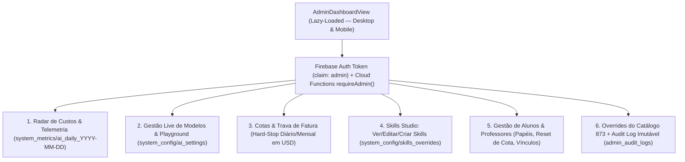

# 04 — Plano Técnico: Área de Administrador (`Admin Control Center`)

## Visão Geral do Objetivo (`Goal Description`)

Com a introdução dos 4 Agentes Especializados no **DeepInfra**, das **13 Skills Científicas**, do serviço de transcrição de voz, das cotas por usuário e do acompanhamento de professores e alunos, precisamos de uma **Central de Administração (`AdminDashboardView`)** integrada ao próprio aplicativo (responsiva para Desktop e Mobile PWA, carregada sob demanda com `0 KB` de impacto para usuários comuns).

Essa área permitirá **monitorar custos e uso em tempo real, trocar modelos e parâmetros sem novo deploy, testar a API, editar/criar Skills científicas, ajustar cotas e tetos de gasto, apoiar usuários/professores e curar o catálogo de exercícios** — com segurança rigorosa contra escalação de privilégio.

---

## User Review Required

> [!IMPORTANT]
> **Modelo de Segurança e Primeiro Acesso de Administrador (`Bootstrap Seguro`):**
> * Em [firestore.rules](file:///root/superacao-app/firestore.rules#L12-L16), o documento `users/{uid}` é editável pelo próprio usuário logado. Por isso, **o privilégio de Administrador jamais ficará em `users/{uid}`** (o que permitiria auto-promoção via console).
> * A autoridade administrativa residirá exclusivamente em **Firebase Auth Custom Claims (`token.admin == true`)** espelhada na coleção bloqueada **`system_admins/{uid}`** (`allow write: if false` para clientes; escrita exclusiva via Firebase Admin SDK no servidor).
> * Para facilitar sua entrada imediata sem comandos manuais no banco, configuraremos a variável segura `ADMIN_OWNER_EMAILS` na Cloud Function: assim que você fizer login com seu e-mail verificado (`email_verified == true`), o sistema habilitará automaticamente seu selo **`🛡️ Painel Admin`** no topo/[ProfileView.tsx](file:///root/superacao-app/src/views/ProfileView.tsx).

## Decisões Confirmadas

1. **E-mail Proprietário Inicial (`ADMIN_OWNER_EMAILS`):** Confirmado como **`gamamatheus65@gmail.com`** (exigindo `email_verified === true` no token Firebase Auth + suporte adicional a e-mails extras via variável de ambiente `ADMIN_OWNER_EMAILS` no servidor).
2. **Privacidade em Suporte de Usuários (LGPD):** Confirmado o padrão de privacidade por design — na aba **Usuários & Professores**, exibem-se por padrão apenas indicadores operacionais (papel, treinos, vínculo, consumo de cota e tags biomecânicas ativas), mantendo textos brutos de conversas privadas e notas médicas ocultos por padrão e auditando qualquer ação administrativa em `admin_audit_logs`.

---

## Arquitetura dos 6 Módulos do Painel de Administração

### Detalhamento Funcional de Cada Aba do Administrador

| Aba no Painel Admin | O que Você Visualiza | O que Você Pode Modificar / Executar na Hora (Sem Deploy) |
| :--- | :--- | :--- |
| **1. 📊 Custos & Uso (`Overview`)** | Gasto hoje e no mês (USD e R\$), economia gerada pelo *Prefix Cache*, chamadas por agente (`MasterPersonal`, `TeacherCopilot`, `TelemetryAnalyst`, `HabitCompanion`, `VoiceASR`), latência média, taxa de acionamento de *Fallback*, **Taxa de Aceite das Propostas** pelos alunos e total de *Red Flags* médicas bloqueadas. | Filtrar por período (Hoje, 7d, 30d), exportar CSV financeiro/operacional e clicar em **`🔌 Testar Saúde da API DeepInfra`** (mede latência real do Titular e do Fallback de cada agente). |
| **2. 🤖 Modelos & Agentes (`Models`)** | Configuração viva de cada um dos 5 serviços (ex.: `zai-org/GLM-5.3` -> `deepseek-ai/DeepSeek-V4-Pro`), temperaturas, `maxOutputTokens`, timeouts e tabela de preços unitários por 1M tokens. | **Trocar o ID de qualquer modelo Titular ou Fallback**, ligar/desligar um agente individualmente, atualizar o preço por milhão de tokens (para cálculo exato de custo) e usar o **Mini-Playground Administrativo** para testar respostas e ver o JSON/tokens gastos antes de liberar aos usuários. |
| **3. 🛡️ Cotas & Teto Financeiro (`Guardrails`)** | Consumo atual vs. limites por usuário e orçamento global da plataforma. | Ajustar cotas diárias de turnos/áudios para Alunos e Professores, configurar o **Teto Automático Diário/Mensal em Dólares (`dailyHardStopUsd` / `monthlyHardStopUsd`)** (que pausa chamadas pagas e cai para o motor determinístico gratuito se atingido) e acionar o **Kill-Switch Global de Emergência**. |
| **4. 📚 Estúdio de Skills (`Skills`)** | As **13 Skills Científicas de Educação Física**, quantas vezes cada uma foi ativada nos treinos da semana e quais gatilhos (`autoTriggers`) elas usam. | Editar o protocolo científico (`protocolMarkdown`) de qualquer Skill, ativar/pausar uma Skill, **adicionar novas Skills customizadas** ou restaurar o texto original de fábrica com 1 clique. |
| **5. 👥 Usuários & Professores (`Users`)** | Lista paginada e busca rápida por nome, e-mail, UID ou código `PROF-XXXX`; estatísticas de uso, papel atual, vínculo ativo e consumo individual de IA no dia/mês. | Promover/alternar papel (`student` / `teacher` / `admin`), **resetar a cota diária de IA** de um usuário em teste/suporte, bloquear abuso (`aiBlocked`) ou reprocessar/limpar estado travado de proposta/memória. |
| **6. 🏋️ Catálogo & Auditoria (`Catalog & Logs`)** | Busca nos 873 exercícios de [catalog.ts](file:///root/superacao-app/src/data/catalog.ts) com todas as tags de segurança + linha do tempo completa do **`admin_audit_logs`**. | Aplicar **Overrides Instantâneos de Segurança no Catálogo** (ex.: ocultar um exercício problemático, ajustar tag de equipamento ou adicionar contraindicação articular valendo imediatamente para o `workoutEngine` e para os Agentes) e auditar quem alterou qualquer configuração e quando. |

---

## Economia Extrema de Leituras no Firestore (Agregação Atômica)

Um erro comum em painéis administrativos é fazer `getDocs(collection(db, 'logs'))` lendo 50.000 documentos toda vez que o Admin abre o gráfico — o que encareceria o Firestore.

Na nossa arquitetura:
* Toda execução de IA na Cloud Function faz apenas **1 `set(..., { merge: true })` com `FieldValue.increment(...)`** no documento compacto do dia: `system_metrics/ai_daily_{YYYY-MM-DD}` (~2 KB!).
* Abrir o gráfico completo de **30 dias de custos e uso** no Painel Admin consome **apenas 30 leituras de documento no Firestore** (custo virtualmente **R\$ 0,00**!).
* No backend (`functions/`), `system_config/ai_settings` e `system_config/skills_overrides` ficam em **cache em memória RAM com TTL de 60 segundos** (invalidado na hora quando o Admin salva uma mudança via endpoint administrativo), garantindo zero latência extra nas chamadas dos alunos.

---

## Proposed Changes

### Componente A: Segurança, Schemas e Endpoints Administrativos (`functions/` & `firestore.rules`)

#### [NEW] `functions/src/admin/adminAuth.ts`
- Helper `requireAdmin(request)` e `requireSuperAdmin(request)` validando `request.auth.token.admin === true` ou documento em `system_admins/{uid}`.
- Função `bootstrapOwnerAdmin` que concede acesso inicial seguro apenas a contas com `email_verified === true` listadas em `ADMIN_OWNER_EMAILS`.
- Gravador automático `writeAdminAuditLog({ adminUid, adminEmail, action, targetId, before, after })` em `admin_audit_logs`.

#### [NEW] `functions/src/admin/usageLedger.ts`
- Função `recordAiExecutionMetrics()` chamada ao final de toda execução de agente/voz: calcula o custo exato em USD com base na tabela vigente, incrementa `system_metrics/ai_daily_{YYYY-MM-DD}`, incrementa o contador diário do usuário (`users/{uid}/aiQuota/{YYYY-MM-DD}`) e verifica os tetos `dailyHardStopUsd` / `monthlyHardStopUsd`.

#### [NEW] `functions/src/admin/adminCallable.ts`
Endpoints HTTPS `onCall` exclusivos para administradores:
- `adminGetDashboardSnapshot` (métricas agregadas 7d/30d, status de orçamento e contadores gerais);
- `adminUpdateAiSettings` (atualiza modelos, preços, temperaturas, cotas e *kill-switch* + invalida cache + grava audit log);
- `adminTestModelConnection` (testa chamada real enxuta no modelo Titular/Fallback no DeepInfra ou roda o Mini-Playground retornando latência, Skills ativadas e custo);
- `adminUpsertSkillOverride` (edita/cria/restaura Skills em `system_config/skills_overrides`);
- `adminSearchAndManageUsers` (busca usuários/professores, reseta cota diária, ajusta papel/`aiBlocked` ou gerencia `system_admins`);
- `adminUpsertCatalogOverride` (salva ajustes dinâmicos de segurança em `system_config/catalog_overrides`).

#### [MODIFY] [firestore.rules](file:///root/superacao-app/firestore.rules)
- Adicionar helper `isAdmin()` baseado exclusivamente em `request.auth.token.admin == true || exists(/databases/$(database)/documents/system_admins/$(request.auth.uid))`.
- Proteger `system_admins/{uid}`, `system_config/{docId}`, `system_metrics/{docId}` e `admin_audit_logs/{logId}` (`allow write: if false;` direto do cliente — toda escrita administrativa passa validada e auditada pelas Cloud Functions!). Leitura de `system_config/catalog_overrides` pública/autenticada para o motor local respeitar ocultações/tags de catálogo mesmo offline, e leitura de `system_metrics` / `admin_audit_logs` exclusiva para `isAdmin()`.
- Em `users/{uid}`, impedir que clientes gravem campos administrativos reservados (`isAdmin`, `aiBlocked`).

---

### Componente B: Interface do Painel de Administração no PWA (`src/`)

#### [NEW] `src/views/AdminDashboardView.tsx` (e subcomponentes modulares em `src/components/admin/`)
Interface limpa, rápida e responsiva (layout de múltiplas colunas em telas largas de notebook e abas horizontais táteis no celular) contendo as 6 seções:
1. `AdminOverviewTab.tsx` — Cards financeiros (USD/BRL), barras visuais de consumo por agente, economia de cache, taxa de aceite e botão de teste de saúde do DeepInfra;
2. `AdminModelsAndPlaygroundTab.tsx` — Editor dos pares Titular + Fallback dos 5 serviços, parâmetros técnicos, preços por 1M e Mini-Playground interativo;
3. `AdminGuardrailsTab.tsx` — *Kill-switch* global, tetos diário/mensal em dólares e cotas por perfil;
4. `AdminSkillsStudioTab.tsx` — Inspetor e editor das 13+ Skills Científicas com preview e restauração de padrão;
5. `AdminUsersManagerTab.tsx` — Busca de alunos/professores, reset de cota, gestão de papéis e suporte;
6. `AdminCatalogAndAuditTab.tsx` — Curadoria rápida dos 873 exercícios + histórico imutável de auditoria administrativa.

#### [MODIFY] [AuthContext.tsx](file:///root/superacao-app/src/context/AuthContext.tsx), [App.tsx](file:///root/superacao-app/src/App.tsx), [TopStatusBar.tsx](file:///root/superacao-app/src/components/TopStatusBar.tsx) e [ProfileView.tsx](file:///root/superacao-app/src/views/ProfileView.tsx)
- Expor booleano seguro `isAdmin` no `AuthContext` (lendo Custom Claim `idTokenResult.claims.admin` / `system_admins/{uid}`).
- Em `App.tsx`, carregar `AdminDashboardView` via `lazyWithRetry` apenas quando `isAdmin && isAdminOpen`.
- Exibir botão discreto **`🛡️ Admin`** na `TopStatusBar` e no `ProfileView` **exclusivamente** quando `isAdmin === true`.

---

## Verification Plan

### Automated Tests
1. **Testes de Segurança Anti-Escalação e Governança (`Vitest`):**
   - Garantir que usuários não-admin recebem `permission-denied` em qualquer endpoint `admin*` e não conseguem auto-atribuir privilégio de admin;
   - Testar que alterações em `system_config/ai_settings` (troca de modelo, *kill-switch*, `dailyHardStopUsd` atingido e *override* de Skill/Catálogo) mudam imediatamente o comportamento do runtime dos agentes e geram registro em `admin_audit_logs`;
   - Testar o cálculo exato de custos no `usageLedger.ts` (incluindo desconto de `cachedInputTokens` e minutos de áudio).
2. **Testes E2E Desktop & Mobile (`Playwright`):**
   - Verificar que contas normais de aluno/professor **não** veem o atalho de Admin;
   - Verificar em conta Admin a navegação completa pelas 6 abas do `AdminDashboardView` (em viewport Desktop `1280×800` e Mobile Pixel 5 `393×851`), edição de modelo/cota/Skill e registro de auditoria.

### Manual Verification
1. Autenticar com o e-mail proprietário configurado em `ADMIN_OWNER_EMAILS`, abrir o **`🛡️ Painel Admin`**, clicar em **`🔌 Testar Saúde da API DeepInfra`** e executar um teste no Mini-Playground conferindo tokens, Skills acionadas e custo calculado na aba de Custos.
